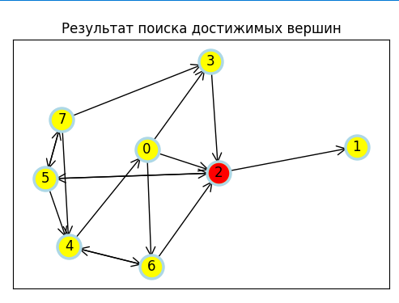

# Алгоритмы и структуры данных на Python

Лабораторные и курсовая по курсу «Алгоритмы и структуры данных». У всех программ оконный интерфейс на Tkinter.

## Курсовая

[course-project](course-project)

Две программы:

- **Библиотека меломана** ([music_library.py](course-project/music_library.py)): справочник музыкальных альбомов. Можно добавлять альбомы, искать по исполнителю, смотреть список жанров и дерево «исполнитель - альбомы». Данные хранятся в списке, жанры во множестве, иерархия в дереве, всё сохраняется в JSON.
- **Достижимые вершины** ([reachable_vertices.py](course-project/reachable_vertices.py)): генерирует случайный ориентированный граф и находит все вершины, достижимые из заданной, обходом в глубину через стек. Граф рисуется через networkx.

| Библиотека меломана | Поиск достижимых вершин |
|---|---|
|  |  |

## Лабораторные

| Папка | Тема | Что внутри |
|---|---|---|
| [lab1-approximation](lab1-approximation) | Аппроксимация и интерполяция | метод наименьших квадратов, многочлен Лагранжа, графики ошибок. В папке `matlab` тот же пример на MATLAB через `polyfit` |
| [lab2-sorting](lab2-sorting) | Сортировки | пузырьком, поразрядная, подсчётом, блинная, битоническая, пирамидальная. Массив генерируется или читается из файла, время каждой сортировки записывается в `results.txt` |
| [lab3-searching](lab3-searching) | Поиск | линейный, с барьером, интерполяционный, прыжками. Сравнение времени на массиве из 1000 элементов |

## Запуск

```
pip install numpy scipy matplotlib pandas networkx
python course-project/music_library.py
```

---

Учебная работа, РГУ нефти и газа им. Губкина
